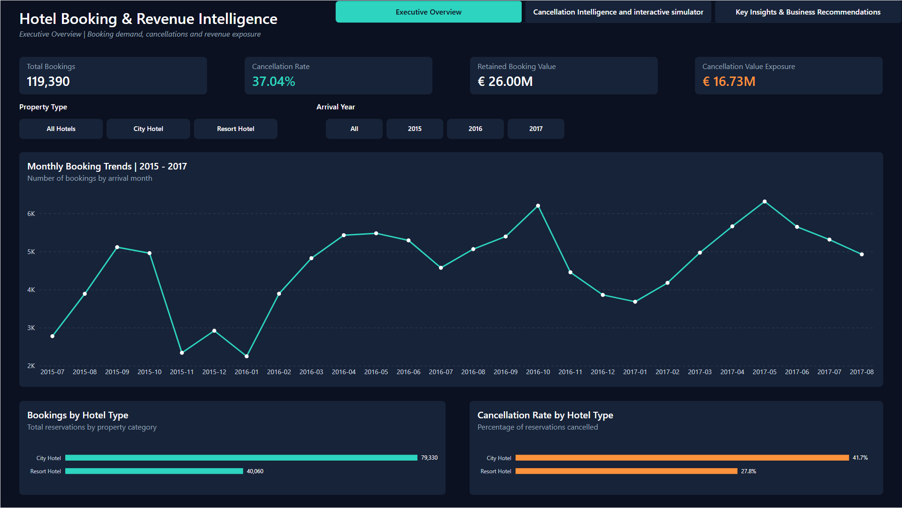
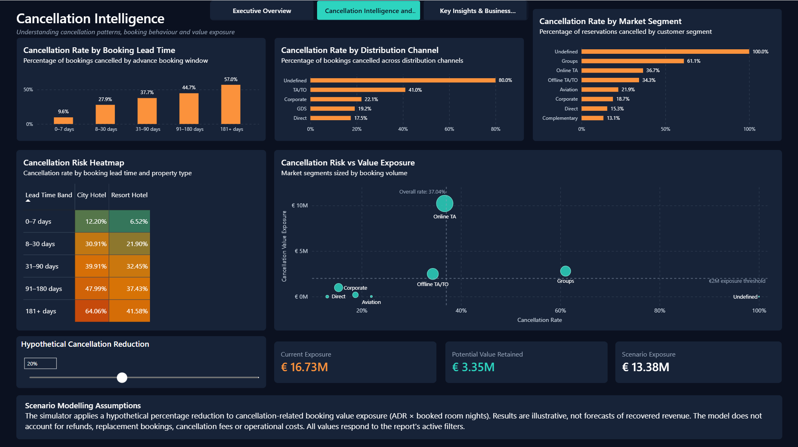
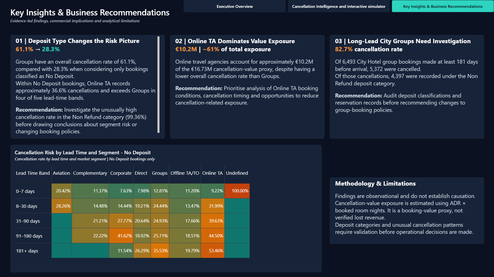

# Hotel Booking & Revenue Intelligence

**Power BI | DAX | Power Query | Data Analytics**

An interactive, three-page Power BI report analysing 119,390 hotel bookings to investigate cancellation behaviour, booking-value exposure and commercially relevant patterns. The project moves beyond headline cancellation rates by comparing booking segments within more comparable deposit categories and lead-time groups.

## Dashboard Preview

### 1. Executive Overview



Booking KPIs, demand trends, hotel comparisons and interactive filters.

### 2. Cancellation Intelligence



Cancellation-risk breakdowns, lead-time heatmaps, risk-versus-value analysis and an interactive scenario simulator.

### 3. Key Insights & Business Recommendations



Evidence-led findings, recommended investigations and a contextual heatmap tooltip.

## Dataset

- **Source:** [Hotel Booking Demand dataset (TidyTuesday CSV)](https://raw.githubusercontent.com/rfordatascience/tidytuesday/master/data/2020/2020-02-11/hotels.csv), based on António, Almeida and Nunes (2019).
- **Coverage:** 119,390 bookings across two Portuguese hotels (79,330 City Hotel; 40,060 Resort Hotel).
- **Arrival dates:** July 2015–August 2017.
- **Technology:** Power BI Desktop, Power Query, DAX and dimensional data modelling.

## Performance Snapshot

| Metric | Result |
|---|---:|
| Total bookings | 119,390 |
| Cancelled bookings | 44,224 |
| Cancellation rate | 37.04% |
| Retained booking-value proxy | ~€26.00M |
| Cancellation-value exposure proxy | ~€16.73M |

> **Interpretation:** Booking value is estimated as **ADR × booked room nights**. It is not verified revenue or actual financial loss. The euro symbol is a display assumption; the source currency has not been independently verified.

## Key Findings

**1. Aggregate segment rankings can be misleading.**

Groups have a **61.06%** cancellation rate overall (12,097 of 19,811 bookings), but **28.30%** within the No Deposit subset (2,974 of 10,509). Within that subset, Online TA has a higher cancellation rate than Groups in four of five lead-time bands. This is a descriptive comparison, not evidence of causation.

**2. Deposit classification warrants investigation.**

The Non Refund category has **14,494 cancellations out of 14,587 bookings (99.36%)**. This unusual pattern should be audited before drawing conclusions about policy effectiveness or lost revenue.

**3. Value exposure and cancellation rate tell different stories.**

Online TA accounts for approximately **€10.2M** of **€16.73M** in cancellation-related booking-value exposure (about **61%**), making it a priority for further investigation despite not having the highest overall cancellation rate.

## Technical Implementation

- Prepared and transformed booking data in Power Query.
- Modelled bookings with a fact table and supporting dimensions for dates, hotels, channels and market segments.
- Built reusable DAX measures for booking volume, cancellations, rates and booking-value proxies.
- Developed interactive heatmaps, slicers, tooltips and risk-versus-exposure visualisations.
- Added a What-if parameter to illustrate the effect of a hypothetical 0–50% reduction in cancellation-value exposure.

### Scenario Modelling

The simulator applies a user-selected percentage to the existing cancellation-value exposure:

```dax
Potential Value Retained =
[Cancellation Value Exposure] * [Selected Cancellation Reduction]
```

```dax
Scenario Cancellation Exposure =
[Cancellation Value Exposure] - [Potential Value Retained]
```

This is illustrative scenario analysis, not a forecast. It does not model refunds, replacement bookings, cancellation fees or operating costs.

## Project Documentation

- **[DAX Measures](DAX_measures.md)** — measure definitions and calculation logic.
- **[Research & Validation Log](Hotel_Booking_Insights_Research_Log.md)** — investigation history, supporting figures, caveats and recommendations.
- **[Power BI Report](Hotel_Booking_Revenue_Intelligence.pbix)** — interactive report for Power BI Desktop.

## Limitations

The dataset covers two historical properties and may not generalise to other hotels. Cancellation-value exposure is not realised revenue loss. The unusual Non Refund category requires validation, and the dataset is insufficient for reliable occupancy or RevPAR calculations. Findings are observational, not causal.

## Skills Demonstrated

**Power BI · DAX · Power Query · Data Modelling · Data Cleaning · Business Intelligence · Exploratory Data Analysis · Data Visualisation · Commercial Analytics**
